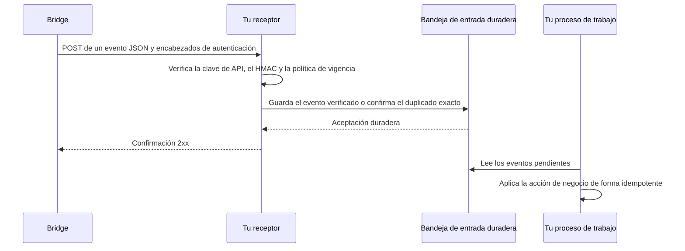

Los webhooks envían eventos **desde Bridge hacia tu sistema**. Configura una URL de recepción HTTPS y suscríbete a las familias de eventos que necesita tu integración. Bridge envía JSON mediante `POST`; tu receptor autentica y almacena el evento antes de devolver `2xx`.

Usa la [API REST de integraciones](/es/credentials) cuando tu sistema necesite leer o modificar un recurso de Bridge. Una suscripción de webhook no crea por sí sola una integración bidireccional completa con un CRM: tu receptor debe relacionar los identificadores, procesar el evento e implementar las escrituras de vuelta que necesites mediante la operación REST documentada.

## Construye el receptor

<Steps>
  <Step title="Elige los eventos">
    Lee la [referencia de eventos](/es/webhooks/events) y elige la familia y la versión de suscripción adecuadas para tu flujo.
  </Step>
  <Step title="Verifica y almacena cada solicitud">
    Sigue [Verificar firmas](/es/webhooks/verifying-signatures) para la serialización HMAC exacta y [Recepción de eventos](/es/webhooks/receive-events) para un ejemplo de almacenamiento duradero.
  </Step>
  <Step title="Configura y prueba la recepción">
    Introduce la URL, la clave de API del webhook y el secreto de cliente en la [consola de administración de Bridge](/es/webhooks/configuration). Comprueba el webhook de prueba antes de habilitar el flujo de negocio.
  </Step>
</Steps>

## Mantén separadas las credenciales

| Encabezado | Finalidad |
| --- | --- |
| `X-Bridge-API-Key` | Clave de API del webhook configurada para esta URL de recepción. Compárala con el valor esperado. |
| `X-Bridge-Signature` | `sha256=` seguido del HMAC-SHA256 de la representación canónica del evento de Bridge, calculado con tu secreto de cliente del webhook. |
| `X-Bridge-Timestamp` | Segundos Unix para comprobar la vigencia en el receptor. El HMAC **no** incluye este encabezado. |

Estas credenciales de webhook son distintas de la `x-api-key` de la API REST y de la `captureKey` de Custom Connections usada en el navegador. Guarda el secreto de cliente del webhook en tu servidor.

## Qué significa la confirmación de recepción

Una respuesta `2xx` significa que tu receptor aceptó el evento. No demuestra que haya terminado la actualización del CRM u otra acción de negocio. Guarda primero el evento y procésalo fuera de la solicitud para que un servicio lento posterior no retrase la confirmación.

El emisor HTTP actual hace tres intentos por operación de entrega, con esperas de uno y dos segundos y un tiempo de espera de socket predeterminado de diez segundos. Esto no promete un total de tres intentos para toda la cadena de procesamiento del evento. Lee el [comportamiento de reintentos, duplicados y orden](/es/webhooks/receive-events) antes de elegir tu política de recuperación.

No asumas entrega exactamente una vez, un orden global de eventos ni un endpoint público de reenvío. La [referencia de eventos](/es/webhooks/events) describe los cuerpos de los eventos; la [guía del receptor](/es/webhooks/receive-events) explica cómo manejarlos de forma confiable.
