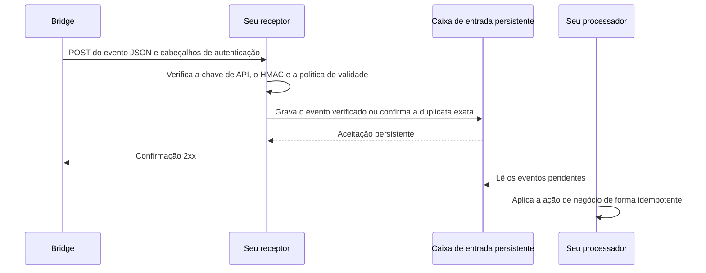

Webhooks enviam eventos **do Bridge para seu sistema**. Configure um callback HTTPS e assine as famílias de eventos de que sua integração precisa. O Bridge envia JSON usando `POST`; seu receptor autentica e armazena o evento antes de retornar `2xx`.

Use a [API REST de integrações](/pt-br/credentials) quando seu sistema precisar ler ou alterar um recurso do Bridge. Uma assinatura de webhook, sozinha, não cria uma integração bidirecional completa com o CRM: seu receptor precisa mapear identificadores, processar o evento e implementar qualquer gravação de volta desejada por meio da operação REST documentada.

## Implemente o receptor

<Steps>
  <Step title="Escolha os eventos">
    Leia a [referência de eventos](/pt-br/webhooks/events) e selecione a família e a versão de assinatura adequadas ao seu fluxo.
  </Step>
  <Step title="Verifique e armazene cada requisição">
    Siga o guia de [verificação de assinaturas](/pt-br/webhooks/verifying-signatures) para a serialização HMAC exata e o de [recebimento de eventos](/pt-br/webhooks/receive-events) para um exemplo de caixa de entrada persistente.
  </Step>
  <Step title="Configure e teste o callback">
    Informe a URL, a chave de API do webhook e o segredo do cliente no [console administrativo do Bridge](/pt-br/webhooks/configuration). Verifique o callback de teste antes de ativar seu fluxo de negócio.
  </Step>
</Steps>

## Mantenha as credenciais separadas

| Cabeçalho | Finalidade |
| --- | --- |
| `X-Bridge-API-Key` | Chave de API do webhook configurada para esse callback. Compare-a com o valor esperado. |
| `X-Bridge-Signature` | `sha256=` seguido do HMAC-SHA256 da representação canônica do evento do Bridge, usando o segredo do cliente do webhook. |
| `X-Bridge-Timestamp` | Segundos Unix usados na verificação de validade temporal pelo receptor. O HMAC **não** inclui esse cabeçalho. |

Essas credenciais de webhook são separadas da `x-api-key` da API REST e da `captureKey` de Custom Connections usada no navegador. Mantenha o segredo do cliente do webhook no servidor.

## O que a confirmação de recebimento significa

Uma resposta `2xx` significa que seu receptor aceitou o evento. Ela não comprova que a atualização do CRM ou outra ação de negócio terminou. Persista primeiro e processe fora da requisição, para que um serviço posterior lento não atrase a confirmação.

O emissor HTTP atual faz três tentativas por operação de entrega, com esperas de um e dois segundos e timeout padrão de dez segundos no socket. Isso não é uma promessa de apenas três tentativas em todo o fluxo do evento. Leia as [regras de novas tentativas, duplicatas e ordenação](/pt-br/webhooks/receive-events) antes de escolher sua política de recuperação.

Não presuma entrega exatamente uma vez, ordem global de eventos ou um endpoint público de reenvio. A [referência de eventos](/pt-br/webhooks/events) descreve os payloads; o [guia do receptor](/pt-br/webhooks/receive-events) explica como tratá-los de forma confiável.
