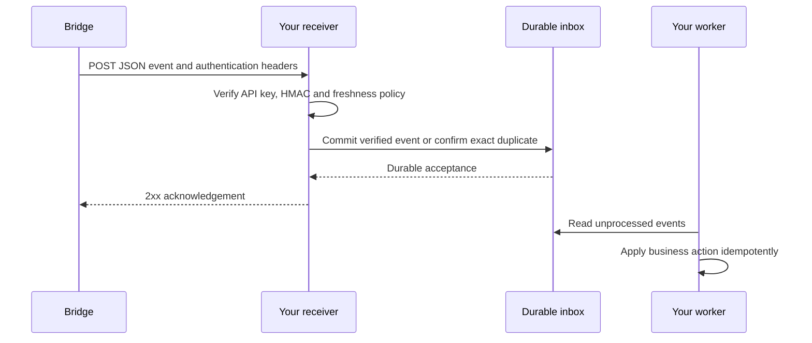

Webhooks send events **from Bridge to your system**. Configure an HTTPS callback and subscribe to the event families your integration needs. Bridge sends JSON using `POST`; your receiver authenticates and stores the event before returning `2xx`.

Use the [REST Integrations API](/credentials) when your system needs to read or change a Bridge resource. A webhook subscription does not create a complete two-way CRM integration by itself: your receiver must map identifiers, process the event and implement any intended write back through the documented REST operation.

## Build the receiver

<Steps>
  <Step title="Choose your events">
    Read the [event reference](/webhooks/events) and select the family and subscription version that matches your workflow.
  </Step>
  <Step title="Verify and store each request">
    Follow [Verify signatures](/webhooks/verifying-signatures) for the exact HMAC serialization and [Receive events](/webhooks/receive-events) for a durable inbox example.
  </Step>
  <Step title="Configure and test the callback">
    Enter the URL, webhook API key and client secret in the [Bridge Admin Console](/webhooks/configuration). Check the test callback before enabling your business workflow.
  </Step>
</Steps>

## Keep the credentials separate

| Header | Purpose |
| --- | --- |
| `X-Bridge-API-Key` | Webhook API key configured for this callback. Compare it with your expected value. |
| `X-Bridge-Signature` | `sha256=` plus HMAC-SHA256 of Bridge's canonical event representation, using your webhook client secret. |
| `X-Bridge-Timestamp` | Unix seconds for a receiver freshness check. The HMAC does **not** include this header. |

These webhook credentials are separate from the REST API's `x-api-key` and the browser's Custom Connections `captureKey`. Keep the webhook client secret on your server.

## What an acknowledgement means

A `2xx` response means your receiver accepted the event. It does not establish that your CRM update or other business action completed. Persist first and process outside the request, so a slow downstream service does not hold up acknowledgement.

The current HTTP sender makes three attempts per delivery operation, with one- and two-second waits and a default ten-second socket timeout. This is not a promise of three attempts across the entire event pipeline. Read [retry, duplicate and ordering behavior](/webhooks/receive-events) before choosing your recovery policy.

Do not assume exactly-once delivery, a global event order, or a public replay endpoint. The [event reference](/webhooks/events) describes payloads; the [receiver guide](/webhooks/receive-events) explains how to handle them reliably.
